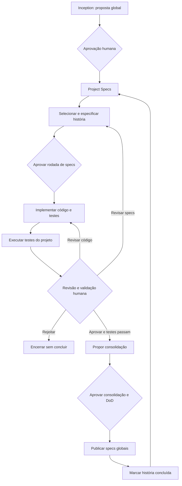
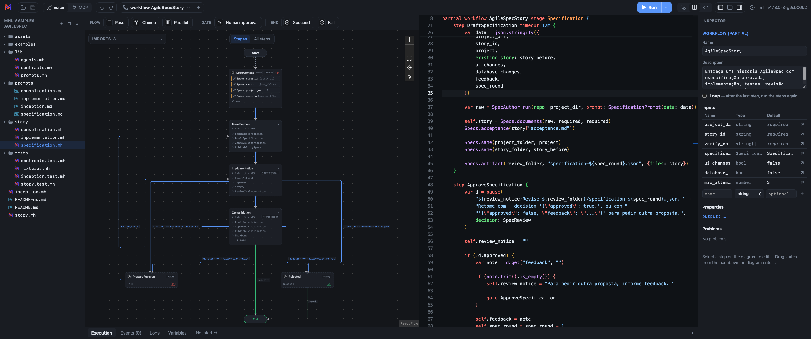

<p align="center">
  
</p>

# AgileSpec em MHL

Implementação executável do ciclo de entrega do [AgileSpec](https://github.com/mtov/AgileSpec)
em **[Meta-Harness Language (MHL)](https://github.com/mh-language/mhl-core-runtime)**,
com arquivos `.mh`. Preserva as especificações em Markdown junto ao código e expressa
a orquestração, decisões humanas, verificações e ciclos de correção em MHL.

Os workflows foram construídos usando o
[MHL Studio](https://mh-language.github.io/mhl-core-runtime/download.html#studio).

O fluxo pressupõe que o discovery já produziu um backlog. Trabalha uma história
por sessão, escolhida por uma pessoa; depois da consolidação, a próxima sessão lê
as especificações globais atualizadas. Não impõe cerimônias ágeis nem um plano
de tarefas ao agente implementador.

## Correspondência com o AgileSpec

| Atividade | Implementação | Condição para avançar |
| --- | --- | --- |
| Inception | `inception.mh` propõe os cinco documentos globais | Aprovação humana antes de gravar |
| Specification | `story.mh` lê specs existentes ou propõe uma versão | Aprovação da rodada de especificação |
| Implementation | Agente edita código e testes usando os dois níveis de specs | Relatório estruturado e specs preservadas |
| Review and Verification | MHL executa o comando de testes; pessoa revisa e valida manualmente | Testes aprovados e aprovação da rodada implementada |
| Correção | Volta à implementação ou à especificação com feedback (decisão `Revise`) | Nova aprovação; no máximo `max_attempts` implementações |
| Consolidation | Propõe documentos globais a partir da história e do código | Sem discrepâncias ou DoD pendente; aprovação humana |
| Conclusão | Publica consolidação e, em seguida, marca só a história selecionada | Confirmação humana de toda a Definition of Done |



## MHL Studio

O [MHL Studio](https://mh-language.github.io/mhl-core-runtime/download.html#studio)
exibe cada workflow como um grafo, com os stages, as transições condicionais, as
pausas de aprovação humana e as ferramentas chamadas em cada passo. Ao lado, o
mesmo workflow pode ser editado como código `.mh`, enquanto o inspetor mostra
nome, descrição e os inputs com tipos e valores padrão:



Com `mhl serve mcp`, `AgileSpecInception` e `AgileSpecStory` ficam expostos como
ferramentas MCP, junto às ferramentas de controle de execução (`mhl_run_start`,
`mhl_run_resume`, `mhl_run_status` etc.).

## Estrutura

```text
mhl-samples-agilespec/
  agilespec                    # CLI que conduz o ciclo passo a passo
  inception.mh                 # entrada de iniciação
  story.mh                     # entrada de entrega de uma história (inputs, estado, LoadContext,
                               # PrepareRevision e Rejected, que valem para a história inteira)
  story/                       # uma fase por arquivo: fragmentos `partial` com `stage` no cabeçalho
    specification.mh           # stage Specification: proposta, aprovação e publicação das specs
    implementation.mh          # stage Implementation: tentativas, verificação e revisão humana
    consolidation.mh           # stage Consolidation: consolidação, Definition of Done e conclusão
  lib/
    agents.mh                  # CLIs de especificação e implementação
    contracts.mh               # documentos, backlog, contratos e testes do projeto
    prompts.mh                 # templates tipados com prompts externos
  prompts/                     # instruções por atividade
  examples/podlite-brief.txt    # exemplo de contexto inicial
  tests/                       # testes MHL e integração real de checkpoint/resume e do CLI
  assets/                      # capturas de tela do MHL Studio
  check.sh                     # verificação local, sem LLM ou rede
```

No projeto atendido, a estrutura original continua sendo:

```text
meu-projeto/
  AgileSpec/
    project/
      backlog.md
      definition-of-done.md
      architecture.md
      database.md
      ui.md
    stories/story1/
      acceptance.md
      design.md
      views.md                 # quando houver UI
      tables.md                # quando houver banco
  .agilespec-mhl/
    inception/project-proposal.json
    story1/
      specification-1.json
      implementation-1.json
      verification-1.json
      consolidation.json
      done.json
```

`acceptance.md` exige seções `Normal Case` e `Edge Cases`. `views.md` e `tables.md`
são opcionais; arquivos já existentes sempre entram no contexto e na consolidação.
Quando `ui_changes=true` ou `database_changes=true`, o documento correspondente
passa a ser obrigatório. Documentos globais sem aplicação ao projeto podem declarar
isso explicitamente.

O backlog usa a convenção dos exemplos originais: `1. [ ] Descrição`,
`2. [ ] Descrição`, etc. `story_id=1` identifica a entrada `1.` e a pasta `story1`.
Histórias concluídas têm `[x]`. IDs duplicados, inválidos ou já concluídos são recusados.

## Instalar MHL e MHL Studio

Instruções resumidas da [página de download](https://mh-language.github.io/mhl-core-runtime/download.html)
e do [repositório](https://github.com/mh-language/mhl-core-runtime) do MHL. Consulte-os
para detalhes e mudanças recentes.

### CLI `mhl`

Este projeto usa o **MHL 1.13.0**. Os comandos abaixo fixam essa versão.

macOS e Linux:

```sh
curl -fsSL https://raw.githubusercontent.com/mh-language/mhl-core-runtime/main/install.sh | MHL_VERSION=1.13.0 sh
```

Windows (PowerShell):

```powershell
$env:MHL_VERSION = "1.13.0"
irm https://raw.githubusercontent.com/mh-language/mhl-core-runtime/main/install.ps1 | iex
```

O instalador coloca o `mhl` em `~/.mhl/bin` (`%LOCALAPPDATA%\mhl\bin` no Windows) e
o adiciona ao `PATH`. Abra um novo terminal e verifique se a versão é a 1.13.0:

```sh
mhl version
```

- No macOS e Linux, `MHL_VERSION` deve ficar do lado do `sh` no pipe. Sem essa
  variável, é instalada a versão estável mais recente. `MHL_INSTALL_DIR` altera o
  diretório de instalação.
- Há binários para Linux (amd64, arm64), macOS Apple Silicon e Windows (amd64, arm64).
  Para Mac Intel, compile a partir do código-fonte (`cd src/mhl-runtime && make build`)
  ou use o MHL Studio.
- Se o VS Code estiver instalado, o script também instala a extensão da linguagem.
  Para instalá-la manualmente: `code --install-extension mhl-language.mhl-language`.

### MHL Studio

O MHL Studio é um aplicativo desktop para macOS, Windows e Linux, com o runtime
incluído. Os instaladores são publicados nas releases `studio-v` do GitHub, acessíveis
pelo link **Download mhl studio** da
[página de download](https://mh-language.github.io/mhl-core-runtime/download.html#studio).

Se ainda não houver release disponível, compile a partir do código-fonte
(requer Go, Node 22 e Rust):

```sh
git clone https://github.com/mh-language/mhl-core-runtime
cd mhl-core-runtime/src/mhl-studio
npm install
npm run tauri build   # gera um instalador para esta máquina
```

Na primeira execução:

- **macOS:** arraste para Aplicativos. Se o sistema bloquear a abertura, use
  clique direito → Abrir ou
  `xattr -dr com.apple.quarantine "/Applications/mhl studio.app"`.
- **Windows:** no SmartScreen, clique em *Mais informações* → *Executar assim mesmo*.
- **Linux:** `chmod +x mhl.studio_*.AppImage` e execute o AppImage, ou instale o
  pacote `.deb`/`.rpm` pelo gerenciador de pacotes.

Abra a pasta deste repositório no Studio para visualizar e editar `inception.mh` e
`story.mh`.

## Pré-requisitos e agentes

Validado com **MHL 1.13.0** e Python 3. Python é usado para executar o comando de
testes no diretório do projeto e pelos testes de integração; a máquina de estados,
os contratos, as pausas e as decisões estão em MHL.

Os agentes padrão chamam diretamente uma CLI compatível com `claude -p PROMPT`.
Para execução real, ela deve estar instalada, autenticada e configurada com as
permissões necessárias para o projeto. Podem ser selecionados executáveis distintos:

```sh
export AGILESPEC_SPEC_CMD=claude
export AGILESPEC_CODE_CMD=claude
```

Para outra interface de CLI, adapte `command`, `args` e, se necessário, `stdin` em
`lib/agents.mh`, mantendo os contratos JSON descritos nos prompts. Não há credenciais
no código. O agente de especificação apenas propõe JSON; o MHL valida nomes e conteúdo
e grava os documentos após aprovação. O agente de implementação edita código e testes.

Cada chamada tem timeout. A implementação não possui retry automático ou cache;
uma retomada deve examinar o checkout atual. Propostas de especificação têm cache
de dez minutos, com o diretório do projeto incluído no contexto.

## Usar com o CLI `agilespec`

O `agilespec`, na raiz deste repositório, conduz o ciclo passo a passo. Ele chama
`mhl run` dentro da pasta do projeto, guarda as sessões do projeto, mostra o que
revisar em cada pausa (proposta, testes, relatório do agente, evidências) e
pergunta a decisão, retomando até a próxima pausa. Requer Python 3 e o `mhl` no
`PATH`.

```sh
export AGILESPEC_PROJECT=/caminho/absoluto/meu-projeto
alias agilespec=/caminho/para/mhl-samples-agilespec/agilespec

agilespec inception --brief examples/podlite-brief.txt
agilespec story 1 --draft --verify "python3 -m pytest"
agilespec status
agilespec next
```

Num terminal, `inception` e `story` já perguntam cada decisão. Em `q` (ou
Ctrl-D), a sessão fica pausada; `agilespec next` a retoma. O projeto é
`--project`, senão `$AGILESPEC_PROJECT`, senão a pasta atual.

| Comando | O que faz |
| --- | --- |
| `inception --brief ARQUIVO` | Propõe as specs globais a partir do brief (arquivo, texto ou `-`) |
| `story ID [--draft] [--ui] [--db] [--verify CMD]` | Especifica, implementa e consolida a história `ID`; o comando de testes fica guardado para as próximas |
| `next` | Mostra a pausa pendente, pergunta a decisão e continua; numa falha, oferece tentar o passo de novo |
| `status` / `show` | Lista as sessões / mostra de novo a última pausa ou o desfecho |
| `approve [--dod]` · `revise "feedback" [--specs]` · `reject` | Decidem sem perguntas, para scripts; aprovar a consolidação exige `--dod` |
| `decide JSON` | Responde a pausa com a decisão JSON do tipo esperado |
| `redo FASE` | Refaz `Specification`, `Implementation` ou `Consolidation` |

Com mais de uma sessão em aberto, escolha uma com `-s <sessão>`. Uma história
recomeçada depois de concluída ou rejeitada ganha uma sessão nova (`story-2-2`).
O estado fica no projeto: `.mhl/` e `.mhl-cache/` (runtime) e
`.agilespec-mhl/cli.json` (CLI); inclua `.mhl/` e `.mhl-cache/` no `.gitignore`
do projeto. A seção seguinte, "Executar apenas com MHL", mostra o mesmo ciclo
com `mhl run` diretamente, sem o CLI.

## Executar apenas com MHL

Esta seção usa só o `mhl`, sem o CLI `agilespec`: cada passo é um `mhl run`, e
cada decisão é passada com `--decision`.

Execute os exemplos abaixo a partir da raiz deste repositório. Use um diretório
absoluto para o projeto e uma sessão própria para cada iniciação/história.
Mantenha o mesmo diretório de execução, arquivo de entrada e nome de sessão nas
retomadas. Não execute sessões concorrentes para a mesma história ou para
consolidações no mesmo projeto.

### 1. Iniciação

Se `AgileSpec/project/` já contém os cinco documentos, avance para a história.
Para um projeto novo, crie seu diretório e informe o contexto e backlog priorizado:

```sh
export AGILESPEC_PROJECT=/caminho/absoluto/meu-projeto
mkdir -p "$AGILESPEC_PROJECT"
mhl run inception.mh --session meu-projeto-inception \
  --input "project_dir=$AGILESPEC_PROJECT" \
  --input "brief=$(cat examples/podlite-brief.txt)"
```

O workflow pausa em `ApproveInception`, aguardando uma decisão do tipo `bool`.
Revise o conteúdo de `$AGILESPEC_PROJECT/.agilespec-mhl/inception/project-proposal.json`.
Para aprovar:

```sh
mhl run inception.mh --session meu-projeto-inception --resume --decision true
```

`--decision false` descarta a proposta e encerra a sessão. Para pedir outra
proposta, inicie uma nova sessão com o brief corrigido. Editar o JSON de revisão
não edita a proposta armazenada.

### 2. Especificar e implementar uma história

Selecione a história do backlog. Use `Draft` para criar/propor specs e `Existing`
(padrão) para ler specs já preparadas. Ambas as opções exigem aprovação humana.
O comando de verificação é um array JSON de argumentos e deve executar os testes
reais do projeto; ajuste-o à sua stack.

```sh
mhl run story.mh --session meu-projeto-story1 \
  --input "project_dir=$AGILESPEC_PROJECT" \
  --input story_id=1 \
  --input specification_mode=Draft \
  --input ui_changes=true \
  --input database_changes=true \
  --input 'verify_command=["python3","-m","pytest"]'
```

Revise `.agilespec-mhl/story1/specification-1.json`. A proposta ainda não alterou
as especificações oficiais. Cada aprovação é uma **decisão** passada na retomada
(`--decision '<json>'`). Ela é validada contra o tipo que a pausa espera antes de
qualquer passo rodar, e responde só àquela pausa: uma decisão antiga nunca aprova
uma rodada nova. A saída da pausa (`--format json`) mostra em `awaiting` o passo e
o formato esperado. Para aprovar e iniciar a implementação:

```sh
mhl run story.mh --session meu-projeto-story1 --resume --decision '{"approved": true}'
```

Para pedir outra proposta, use `'{"approved": false, "feedback": "..."}'`. A
especificação é redigida de novo como `specification-2.json` e volta a pedir
aprovação.

O agente implementa a história, e MHL executa `verify_command` no diretório do
projeto, registrando saída, erros e código de saída. Em `ReviewImplementation`,
revise o diff, `implementation-1.json`, `verification-1.json` e a Definition of Done;
execute os passos de validação manual relatados pelo agente.

### 3. Aprovar, corrigir ou rejeitar

Após revisão e validação manual satisfatórias:

```sh
mhl run story.mh --session meu-projeto-story1 --resume --decision '{"action": "Approve"}'
```

Uma implementação bloqueada ou com testes reprovados não pode ser aprovada: a
pausa pergunta de novo, dizendo o motivo. Para solicitar correção de código:

```sh
mhl run story.mh --session meu-projeto-story1 --resume --decision \
  '{"action": "Revise", "feedback": "Corrigir o comportamento com URL inválida.", "revise_specs": false}'
```

Use `"revise_specs": true` se o problema exigir corrigir requisitos ou decisões.
Nesse caso, o workflow prepara `specification-2.json` e pede uma nova aprovação
de specs antes de reimplementar. A nova implementação pede uma nova revisão.

`{"action": "Reject"}` encerra a sessão sem concluir a história. Uma correção sem
feedback é recusada (a pausa pergunta de novo), e `max_attempts` limita as
implementações a três por padrão (aceita inteiros de 1 a 20).

### 4. Consolidar e concluir

A aprovação da implementação gera `consolidation.json`, preservando a história
desmarcada no backlog. O agente compara código e specs antes de propor:

| Origem | Destino |
| --- | --- |
| `acceptance.md` | Resumo em `backlog.md`, ainda com `[ ]` |
| `design.md` | `architecture.md` |
| `views.md`, se existente | `ui.md` |
| `tables.md`, se existente | `database.md` |

Discrepâncias ou critérios pendentes da Definition of Done aparecem na mensagem
da pausa e impedem a aprovação. Revise a proposta e confirme todos os critérios:

```sh
mhl run story.mh --session meu-projeto-story1 --resume \
  --decision '{"action": "Approve", "dod_confirmed": true}'
```

Se a consolidação revelar um problema, responda com `"action": "Revise"`
(`feedback` e `revise_specs` como na revisão de código) ou `"Reject"`. Para só
pedir outra proposta de consolidação, refaça a fase:

```sh
mhl run story.mh --session meu-projeto-story1 --resume --from Consolidation
```

O MHL publica os documentos globais e só depois altera a checkbox da história
selecionada. Mantém os arquivos da história para rastreabilidade e registra
`done.json`. Comece outra sessão para selecionar a próxima história, agora com
as especificações globais consolidadas.

## Checkpoints e limites

- `--resume` retoma o passo pausado ou que falhou. Numa pausa de aprovação, uma
  retomada sem `--decision` pausa de novo; a decisão é validada antes de qualquer
  passo e responde só àquela pausa.
- `--resume --from <fase>` refaz uma fase inteira (`Specification`,
  `Implementation`, `Consolidation`) a partir do primeiro passo, com as variáveis
  do momento da parada e descartando a pausa pendente.
- Publicação de documentos e marcação do backlog são idempotentes. A publicação
  aceita uma escrita parcial da mesma proposta e recusa mudanças concorrentes.
- Alterações de specs fora da etapa apropriada interrompem o fluxo. Para trocar
  specs manualmente, faça a alteração e abra uma nova sessão para revisá-las.
  Uma retomada comum não recarrega arbitrariamente arquivos aprovados.
- Um agente de implementação pode ser executado novamente se seu passo falhar.
  Os prompts exigem examinar o estado existente, sem commits, pushes ou deploys.
  Falhas não desfazem automaticamente alterações feitas pelo subprocesso.
- Os contratos e verificações de arquivos não substituem o isolamento do processo
  da CLI. A qualidade da revisão, da cobertura de testes e da confirmação da DoD
  continua sendo responsabilidade humana, conforme o AgileSpec.
- Alterar os `.mh` ou os prompts pode invalidar checkpoints. Use uma nova sessão
  para uma definição alterada. `.mhl/` contém o estado local do runtime e
  `.mhl-cache/` contém o cache de agentes;
  `.agilespec-mhl/` contém propostas e evidências para revisão.

## Verificar a implementação

Da raiz deste repositório:

```sh
./check.sh
```

Esse comando faz lint, executa os testes MHL com um agente local simulado,
valida os dois contratos de entrada com `--dry-run` e exercita checkpoints reais
com `--resume` e com o CLI `agilespec` em projetos temporários. Os dados de teste e caches são criados
em diretórios temporários e removidos ao terminar. Não usa modelos, rede ou credenciais.
Os testes MHL recusam agentes de produção se chamados sem a configuração offline.

Os testes cobrem aprovações, rejeição, falhas de testes, implementação bloqueada,
feedback, limite de correções, revisão de specs, documentos opcionais, discrepâncias,
DoD pendente, alterações concorrentes, publicação parcial e marcação precisa do backlog.
As execuções reais com uma CLI de modelo dependem da configuração local dessa CLI.

## Fontes e licença

Derivado do [README](https://github.com/mtov/AgileSpec), [FAQ](https://github.com/mtov/AgileSpec/blob/main/faq.md) e prompts de
[implementação](https://github.com/mtov/AgileSpec/blob/main/prompts/implementation.md) e
[consolidação](https://github.com/mtov/AgileSpec/blob/main/prompts/consolidation.md) do AgileSpec.
Sintaxe e práticas baseadas nas skills do MHL de
[linguagem](https://github.com/mh-language/mhl-core-runtime/blob/main/skills/mhl-language/SKILL.md),
[workflows](https://github.com/mh-language/mhl-core-runtime/blob/main/skills/mhl-workflows/SKILL.md),
[agentes](https://github.com/mh-language/mhl-core-runtime/blob/main/skills/mhl-agents/SKILL.md),
[ferramentas](https://github.com/mh-language/mhl-core-runtime/blob/main/skills/mhl-tools/SKILL.md) e
[testes](https://github.com/mh-language/mhl-core-runtime/blob/main/skills/mhl-testing/SKILL.md).
O aviso MIT do AgileSpec está preservado em [LICENSE](LICENSE).
