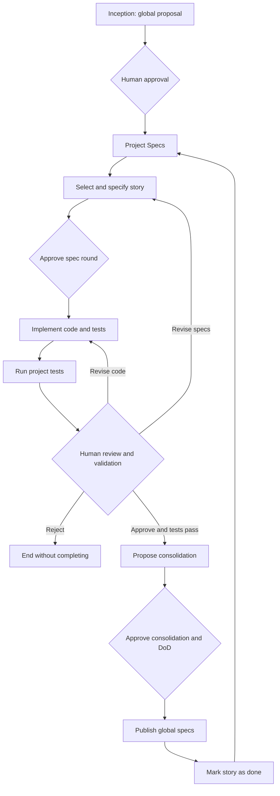
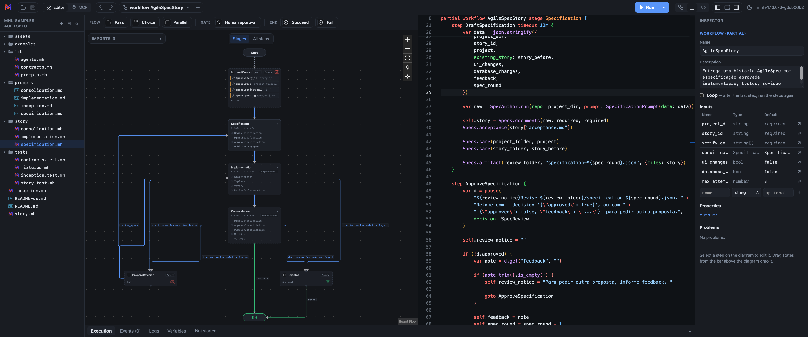

<p align="center">
  
</p>

# AgileSpec in MHL

Executable implementation of the [AgileSpec](https://github.com/mtov/AgileSpec) delivery cycle
in **[Meta-Harness Language (MHL)](https://github.com/mh-language/mhl-core-runtime)**,
using `.mh` files. It keeps the Markdown specifications next to the code and
expresses orchestration, human decisions, checks and correction cycles in MHL.

The workflows were built using
[MHL Studio](https://mh-language.github.io/mhl-core-runtime/download.html#studio).

The flow assumes discovery has already produced a backlog. It works on one story
per session, chosen by a person; after consolidation, the next session reads the
updated global specifications. It does not impose agile ceremonies or a task plan
on the implementing agent.

## Mapping to AgileSpec

| Activity | Implementation | Condition to advance |
| --- | --- | --- |
| Inception | `inception.mh` proposes the five global documents | Human approval before writing |
| Specification | `story.mh` reads existing specs or proposes a version | Approval of the specification round |
| Implementation | Agent edits code and tests using both levels of specs | Structured report and specs preserved |
| Review and Verification | MHL runs the test command; a person reviews and validates manually | Tests pass and the implemented round is approved |
| Correction | Returns to implementation or specification with feedback (`Revise` decision) | New approval; at most `max_attempts` implementations |
| Consolidation | Proposes global documents from the story and the code | No discrepancies or pending DoD; human approval |
| Completion | Publishes the consolidation and then marks only the selected story | Human confirmation of the full Definition of Done |



## MHL Studio

[MHL Studio](https://mh-language.github.io/mhl-core-runtime/download.html#studio)
shows each workflow as a graph, with its stages, conditional transitions, human
approval pauses and the tools called in each step. Beside it, the same workflow
can be edited as `.mh` code, while the inspector shows its name, description and
inputs with types and default values:



With `mhl serve mcp`, `AgileSpecInception` and `AgileSpecStory` are exposed as
MCP tools, alongside the run control tools (`mhl_run_start`, `mhl_run_resume`,
`mhl_run_status`, etc.).

## Structure

```text
mhl-samples-agilespec/
  agilespec                    # CLI that walks through the cycle step by step
  inception.mh                 # inception entry point
  story.mh                     # single-story delivery entry point (inputs, state, LoadContext,
                               # plus PrepareRevision and Rejected, which serve the whole story)
  story/                       # one phase per file: `partial` fragments with a header `stage`
    specification.mh           # stage Specification: spec proposal, approval and publication
    implementation.mh          # stage Implementation: attempts, verification and human review
    consolidation.mh           # stage Consolidation: consolidation, Definition of Done and completion
  lib/
    agents.mh                  # specification and implementation CLIs
    contracts.mh               # documents, backlog, contracts and project tests
    prompts.mh                 # typed templates with external prompts
  prompts/                     # per-activity instructions
  examples/podlite-brief.txt    # sample initial context
  tests/                       # MHL tests and real checkpoint/resume and CLI integration
  assets/                      # MHL Studio screenshots
  check.sh                     # local verification, no LLM or network
```

In the target project, the original structure remains:

```text
my-project/
  AgileSpec/
    project/
      backlog.md
      definition-of-done.md
      architecture.md
      database.md
      ui.md
    stories/story1/
      acceptance.md
      design.md
      views.md                 # when there is UI
      tables.md                # when there is a database
  .agilespec-mhl/
    inception/project-proposal.json
    story1/
      specification-1.json
      implementation-1.json
      verification-1.json
      consolidation.json
      done.json
```

`acceptance.md` requires `Normal Case` and `Edge Cases` sections. `views.md` and
`tables.md` are optional; existing files are always included in the context and in
consolidation. When `ui_changes=true` or `database_changes=true`, the corresponding
document becomes mandatory. Global documents that do not apply to the project may
state so explicitly.

The backlog follows the convention of the original examples: `1. [ ] Description`,
`2. [ ] Description`, etc. `story_id=1` identifies entry `1.` and folder `story1`.
Completed stories are marked `[x]`. Duplicate, invalid or already completed IDs are
rejected.

## Installing MHL and MHL Studio

Summarized from the MHL [download page](https://mh-language.github.io/mhl-core-runtime/download.html)
and [repository](https://github.com/mh-language/mhl-core-runtime). Check them for
details and recent changes.

### `mhl` CLI

This project uses **MHL 1.13.0**. The commands below pin that version.

macOS and Linux:

```sh
curl -fsSL https://raw.githubusercontent.com/mh-language/mhl-core-runtime/main/install.sh | MHL_VERSION=1.13.0 sh
```

Windows (PowerShell):

```powershell
$env:MHL_VERSION = "1.13.0"
irm https://raw.githubusercontent.com/mh-language/mhl-core-runtime/main/install.ps1 | iex
```

The installer puts `mhl` in `~/.mhl/bin` (`%LOCALAPPDATA%\mhl\bin` on Windows) and
adds it to your `PATH`. Open a new terminal and check that the version is 1.13.0:

```sh
mhl version
```

- On macOS and Linux, `MHL_VERSION` must be on the `sh` side of the pipe. Without
  it, the latest stable release is installed. `MHL_INSTALL_DIR` changes the install
  directory.
- Binaries are available for Linux (amd64, arm64), Apple Silicon macOS and Windows
  (amd64, arm64). On Intel Macs, build from source (`cd src/mhl-runtime && make build`)
  or use MHL Studio.
- If VS Code is installed, the script also installs the language extension.
  To install it manually: `code --install-extension mhl-language.mhl-language`.

### MHL Studio

MHL Studio is a desktop app for macOS, Windows and Linux, with the runtime bundled.
Installers are published in the `studio-v` GitHub releases, linked from
**Download mhl studio** on the
[download page](https://mh-language.github.io/mhl-core-runtime/download.html#studio).

If no release is available yet, build it from source (requires Go, Node 22 and Rust):

```sh
git clone https://github.com/mh-language/mhl-core-runtime
cd mhl-core-runtime/src/mhl-studio
npm install
npm run tauri build   # builds an installer for this machine
```

On first launch:

- **macOS:** drag it to Applications. If macOS blocks it, right-click → Open or run
  `xattr -dr com.apple.quarantine "/Applications/mhl studio.app"`.
- **Windows:** in SmartScreen, click *More info* → *Run anyway*.
- **Linux:** `chmod +x mhl.studio_*.AppImage` and run the AppImage, or install the
  `.deb`/`.rpm` package with your package manager.

Open this repository's folder in Studio to view and edit `inception.mh` and
`story.mh`.

## Prerequisites and agents

Validated with **MHL 1.13.0** and Python 3. Python is used to run the test command
in the project directory and by the integration tests; the state machine,
contracts, pauses and decisions are in MHL.

The default agents call a CLI compatible with `claude -p PROMPT` directly.
For real runs, it must be installed, authenticated and configured with the
permissions the project needs. Separate executables can be selected:

```sh
export AGILESPEC_SPEC_CMD=claude
export AGILESPEC_CODE_CMD=claude
```

For a different CLI interface, adapt `command`, `args` and, if needed, `stdin` in
`lib/agents.mh`, keeping the JSON contracts described in the prompts. There are no
credentials in the code. The specification agent only proposes JSON; MHL validates
names and content and writes the documents after approval. The implementation agent
edits code and tests.

Every call has a timeout. Implementation has no automatic retry or cache;
a resume must examine the current checkout. Specification proposals are cached
for ten minutes, with the project directory included in the context.

## Using the `agilespec` CLI

`agilespec`, at the root of this repository, walks through the cycle step by
step. It calls `mhl run` inside the project folder, keeps the project's sessions,
shows what to review at each pause (proposal, tests, agent report, evidence) and
asks for the decision, resuming until the next pause. It needs Python 3 and `mhl`
on the `PATH`.

```sh
export AGILESPEC_PROJECT=/absolute/path/my-project
alias agilespec=/path/to/mhl-samples-agilespec/agilespec

agilespec inception --brief examples/podlite-brief.txt
agilespec story 1 --draft --verify "python3 -m pytest"
agilespec status
agilespec next
```

In a terminal, `inception` and `story` ask each decision right away. At `q` (or
Ctrl-D), the session stays paused; `agilespec next` resumes it. The project is
`--project`, else `$AGILESPEC_PROJECT`, else the current folder.

| Command | What it does |
| --- | --- |
| `inception --brief FILE` | Proposes the global specs from the brief (a file, the text, or `-`) |
| `story ID [--draft] [--ui] [--db] [--verify CMD]` | Specifies, implements and consolidates story `ID`; the test command is kept for the next ones |
| `next` | Shows the pending pause, asks for the decision and goes on; after a failure, offers to run the step again |
| `status` / `show` | Lists the sessions / shows the last pause or outcome again |
| `approve [--dod]` · `revise "feedback" [--specs]` · `reject` | Decide without questions, for scripts; approving the consolidation needs `--dod` |
| `decide JSON` | Answers the pause with a JSON decision of the expected type |
| `redo STAGE` | Redoes `Specification`, `Implementation` or `Consolidation` |

With more than one session open, pick one with `-s <session>`. A story started
again after it was completed or rejected gets a new session (`story-2-2`).
State lives in the project: `.mhl/` and `.mhl-cache/` (runtime) and
`.agilespec-mhl/cli.json` (CLI); add `.mhl/` and `.mhl-cache/` to the project's
`.gitignore`. The next section, "Running with MHL only", shows the same cycle
with `mhl run` directly, without the CLI.

## Running with MHL only

This section uses `mhl` alone, without the `agilespec` CLI: each step is an
`mhl run`, and each decision is passed with `--decision`.

Run the examples below from the root of this repository. Use an absolute path for
the project and a dedicated session for each inception/story. Keep the same
working directory, entry file and session name when resuming. Do not run
concurrent sessions for the same story or for consolidations in the same project.

### 1. Inception

If `AgileSpec/project/` already contains the five documents, skip to the story.
For a new project, create its directory and provide the context and prioritized backlog:

```sh
export AGILESPEC_PROJECT=/absolute/path/my-project
mkdir -p "$AGILESPEC_PROJECT"
mhl run inception.mh --session my-project-inception \
  --input "project_dir=$AGILESPEC_PROJECT" \
  --input "brief=$(cat examples/podlite-brief.txt)"
```

The workflow pauses at `ApproveInception`, waiting for a `bool` decision. Review
the contents of `$AGILESPEC_PROJECT/.agilespec-mhl/inception/project-proposal.json`.
To approve:

```sh
mhl run inception.mh --session my-project-inception --resume --decision true
```

`--decision false` discards the proposal and ends the session. To request a
different proposal, start a new session with the corrected brief. Editing the
review JSON does not edit the stored proposal.

### 2. Specify and implement a story

Select the story from the backlog. Use `Draft` to create/propose specs and `Existing`
(default) to read specs already prepared. Both options require human approval.
The verification command is a JSON array of arguments and must run the project's
real tests; adjust it to your stack.

```sh
mhl run story.mh --session my-project-story1 \
  --input "project_dir=$AGILESPEC_PROJECT" \
  --input story_id=1 \
  --input specification_mode=Draft \
  --input ui_changes=true \
  --input database_changes=true \
  --input 'verify_command=["python3","-m","pytest"]'
```

Review `.agilespec-mhl/story1/specification-1.json`. The proposal has not yet changed
the official specifications. Each approval is a **decision** passed on resume
(`--decision '<json>'`). It is checked against the type the pause waits for before
any step runs, and answers that pause only: an old decision never approves a new
round. The pause's output (`--format json`) shows the step and the expected shape in
`awaiting`. To approve and start implementation:

```sh
mhl run story.mh --session my-project-story1 --resume --decision '{"approved": true}'
```

To request another proposal, use `'{"approved": false, "feedback": "..."}'`. The
specification is drafted again as `specification-2.json` and asks for approval again.

The agent implements the story, and MHL runs `verify_command` in the project
directory, recording output, errors and exit code. At `ReviewImplementation`,
review the diff, `implementation-1.json`, `verification-1.json` and the Definition
of Done; carry out the manual validation steps reported by the agent.

### 3. Approve, revise or reject

After a satisfactory review and manual validation:

```sh
mhl run story.mh --session my-project-story1 --resume --decision '{"action": "Approve"}'
```

A blocked implementation or one with failing tests cannot be approved: the pause
asks again, saying why. To request a code fix:

```sh
mhl run story.mh --session my-project-story1 --resume --decision \
  '{"action": "Revise", "feedback": "Fix the behavior with an invalid URL.", "revise_specs": false}'
```

Use `"revise_specs": true` if the problem requires correcting requirements or
decisions. The workflow then prepares `specification-2.json` and asks for a new
spec approval before reimplementing. The new implementation asks for a new review.

`{"action": "Reject"}` ends the session without completing the story. A revision
without feedback is refused (the pause asks again), and `max_attempts` limits
implementations to three by default (accepts integers from 1 to 20).

### 4. Consolidate and complete

Approving the implementation generates `consolidation.json`, keeping the story
unchecked in the backlog. The agent compares code and specs before proposing:

| Source | Destination |
| --- | --- |
| `acceptance.md` | Summary in `backlog.md`, still `[ ]` |
| `design.md` | `architecture.md` |
| `views.md`, if present | `ui.md` |
| `tables.md`, if present | `database.md` |

Discrepancies or pending Definition of Done criteria appear in the pause's message
and block approval. Review the proposal and confirm every criterion:

```sh
mhl run story.mh --session my-project-story1 --resume \
  --decision '{"action": "Approve", "dod_confirmed": true}'
```

If consolidation reveals a problem, answer with `"action": "Revise"` (`feedback`
and `revise_specs` as in the code review) or `"Reject"`. To only ask for another
consolidation proposal, redo the phase:

```sh
mhl run story.mh --session my-project-story1 --resume --from Consolidation
```

MHL publishes the global documents and only then changes the checkbox of the
selected story. It keeps the story files for traceability and records
`done.json`. Start another session to select the next story, now with the
consolidated global specifications.

## Checkpoints and limits

- `--resume` resumes the paused or failed step. At an approval pause, a resume
  without `--decision` pauses again; the decision is checked before any step and
  answers that pause only.
- `--resume --from <phase>` redoes a whole phase (`Specification`,
  `Implementation`, `Consolidation`) from its first step, with the variables as of
  the stop and the pending pause dropped.
- Document publication and backlog marking are idempotent. Publication accepts a
  partial write of the same proposal and rejects concurrent changes.
- Spec changes outside the appropriate step stop the flow. To change specs
  manually, make the change and open a new session to review them.
  A regular resume does not arbitrarily reload approved files.
- An implementation agent may run again if its step fails.
  The prompts require examining the existing state, with no commits, pushes or deploys.
  Failures do not automatically undo changes made by the subprocess.
- File contracts and checks do not replace process isolation of the CLI. The
  quality of review, test coverage and DoD confirmation remains a human
  responsibility, as in AgileSpec.
- Changing the `.mh` files or prompts may invalidate checkpoints. Use a new session
  for a changed definition. `.mhl/` holds the runtime's local state and
  `.mhl-cache/` holds the agent cache;
  `.agilespec-mhl/` holds proposals and evidence for review.

## Verifying the implementation

From the root of this repository:

```sh
./check.sh
```

This command lints, runs the MHL tests with a simulated local agent, validates
both entry contracts with `--dry-run` and exercises real checkpoints with
`--resume` and with the `agilespec` CLI in temporary projects. Test data and caches are created in temporary
directories and removed at the end. It uses no models, network or credentials.
The MHL tests refuse production agents if called without the offline configuration.

The tests cover approvals, rejection, test failures, blocked implementation,
feedback, the revision limit, spec revision, optional documents, discrepancies,
pending DoD, concurrent changes, partial publication and precise backlog marking.
Real runs with a model CLI depend on that CLI's local configuration.

## Sources and license

Derived from the AgileSpec [README](https://github.com/mtov/AgileSpec), [FAQ](https://github.com/mtov/AgileSpec/blob/main/faq.md) and
[implementation](https://github.com/mtov/AgileSpec/blob/main/prompts/implementation.md) and
[consolidation](https://github.com/mtov/AgileSpec/blob/main/prompts/consolidation.md) prompts.
Syntax and practices based on the MHL skills for
[language](https://github.com/mh-language/mhl-core-runtime/blob/main/skills/mhl-language/SKILL.md),
[workflows](https://github.com/mh-language/mhl-core-runtime/blob/main/skills/mhl-workflows/SKILL.md),
[agents](https://github.com/mh-language/mhl-core-runtime/blob/main/skills/mhl-agents/SKILL.md),
[tools](https://github.com/mh-language/mhl-core-runtime/blob/main/skills/mhl-tools/SKILL.md) and
[testing](https://github.com/mh-language/mhl-core-runtime/blob/main/skills/mhl-testing/SKILL.md).
The AgileSpec MIT notice is preserved in [LICENSE](LICENSE).
